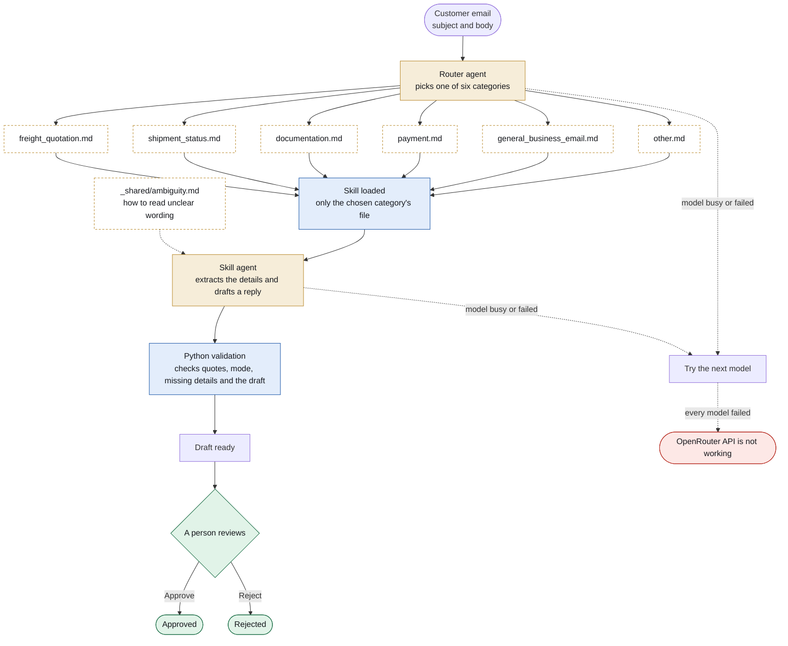

# Hermes Email Assistant

[](https://github.com/Viv-19/hermes-task/actions/workflows/ci-cd.yml)

An AI assistant for **Hermes Travel & Cargo Pvt Ltd**. It reads a customer email, works out what it is about, pulls out the freight details, shows what is missing, and writes a reply for a person to approve.

It never sends email, and it never connects to a real mailbox.

## Workflow

Every email goes through the same steps:



Gold steps use AI, blue steps are plain Python code, and green steps are done by a person. Dashed boxes are the six skill files; the router sees only their one-line descriptions, and only the chosen one is loaded.

1. **Router agent** reads a short description of each category and picks one: Freight Quotation Enquiry, Shipment Status, Documentation, Payment, General Business Email, or Other.
2. **Skill agent** loads only that category's instructions (a Markdown file in `skills/`), extracts the details and drafts the reply. Every skill also gets a shared playbook, `skills/_shared/ambiguity.md`, on how to read unclear wording, and each skill has worked examples.
3. **Validation** is plain Python, with no AI, and runs before anyone sees the result:
   - Every detail must be backed by a quote that really appears in the email.
   - AIR or OCEAN is set only from clear words such as "air freight", "FCL" or "40HC". It is never guessed from the route.
   - What is missing comes from a fixed list for each mode, not from the AI.
   - Weights, Incoterms and dates are checked.
   - A draft may not contain prices, delivery promises, "attached" or status claims. If it does, a safe template is used instead.
   - Text inside an email that tries to give instructions to the AI is ignored and flagged.
4. **A person approves or rejects** the draft.

**Models.** The AI runs on [OpenRouter](https://openrouter.ai), tried in this order:

1. `nemotron-3-ultra-550b-a55b` (free)
2. `nemotron-3-super-120b-a12b` (free)
3. `nemotron-3-super-120b-a12b` (paid, about $0.001 per email)
4. `nemotron-3-ultra-550b-a55b` (paid, about $0.005 per email)
5. `gemma-4-31b-it` (free)

The paid models are a safety net. A model that just failed is skipped for 5 minutes, and when the free daily limit is used up the free models are skipped until midnight UTC, so the paid ones take over and the demo keeps working. If all of them fail, the app shows **"OpenRouter API is not working"**.

## What it does

- **Sorts every email** into one of the six categories.
- **Reads freight enquiries.** It extracts origin, destination, commodity, gross weight and unit, pieces, dimensions or CBM, Incoterm and cargo-ready date, and decides the mode: **AIR, OCEAN or UNKNOWN**.
- **Shows what is missing, unclear or conflicting.** It never invents a detail.
- **Understands unclear wording.** Ranges ("100-120 kg"), vague dates ("end of the month"), "same terms as last time", "air or sea, whichever is faster", several shipments in one email, and attachments it cannot open. It keeps the customer's own words, shows what is unclear, and asks precise questions. It also notes direct questions from the customer, such as "what are our options?".
- **Drafts a reply** that asks only for what is missing, and greets the sender by name when the email is signed.
- **Reads only the newest message** of a reply thread. Forwarded emails are kept, because the request is inside them.
- **Flags emails that ask for two things**, for example "send the B/L and confirm my payment".
- **Copies the extraction as JSON**, so the team can use it as structured data.

## Dashboard

- **Sidebar:** a Dashboard page and one page for each category, with a count of pending emails.
- **Dashboard page:** four counters (Received, Pending, Approved, Rejected), each for the last 24 hours and in total, and the latest emails from every category.
- **Category pages:** the workflow of that category's latest email and its last five emails. Approved emails are green, rejected are red, pending are amber.
- **Send email** (top right): opens a window. After **Analyse**, the workflow above runs live in that window and shows which model was tried, which ones failed, and which one answered. Then you choose **Go to dashboard**.
- **Open an email** to see the draft, what needs attention and the extracted details. From there you can **Approve**, **Reject** (with an optional reason) or **Undo**.

## The four test emails

| Email | Result |
|---|---|
| Air freight rate request – Mumbai to Frankfurt | Freight · **AIR**. Asks for dimensions and the Incoterm. |
| FCL shipment – Nhava Sheva to Hamburg | Freight · **OCEAN (FCL)**. Asks for the commodity and the ready date. |
| Request for shipping documents | **Documentation**, not freight. Asks which shipment. |
| Urgent shipment of pharmaceutical samples | Freight · **UNKNOWN**. Asks for mode, weight, pieces, dimensions, ready date, Incoterm, delivery date and temperature needs. |

Load them with the **Test 1–4** buttons in the Send email window. Ten more edge cases are in the "More…" list. The full real output for each test email, with the quotes and the draft reply, is in [docs/TEST_RESULTS.md](docs/TEST_RESULTS.md).

## Run it on your computer

You need Python 3.11 or newer and an [OpenRouter](https://openrouter.ai/keys) API key.

```bash
git clone https://github.com/Viv-19/hermes-task.git
cd hermes-task
python -m venv .venv
.venv\Scripts\activate          # macOS / Linux: source .venv/bin/activate
pip install -r requirements-dev.txt
cp .env.example .env            # Windows: copy .env.example .env
```

Open `.env` and put your key after `OPENROUTER_API_KEY=`, then start the app:

```bash
uvicorn app.main:app --reload
```

Open <http://127.0.0.1:8000> and click **Send email**.

**No key, or saving your free requests?** Set `MOCK_LLM=1` in `.env`. The app then replays canned answers and never calls OpenRouter.

**Run the tests** (they need no key and no internet): `python -m pytest -q`

## Settings

Set these in `.env`, or as environment variables on the server. The full list is in `.env.example`.

| Name | What it does |
|---|---|
| `OPENROUTER_API_KEY` | Your OpenRouter key. It stays on the server and is never sent to the browser. |
| `MODEL_CHAIN` | The models to try, in order, separated by commas. Models without `:free` are paid. |
| `MODEL_COOLDOWN_S` | How long a model that just failed is skipped (default 300 seconds). |
| `ROUTER_MODE` | `two_stage` (default): router agent, then skill agent, 2 AI requests per email. `single`: one request per email. |
| `MOCK_LLM` | `1` = canned answers, no AI calls. |

## Deploy on Render, with automatic updates

The app runs on Render's free plan. GitHub Actions tests every change and deploys it for you.

**Set up once**

1. On Render, choose **New → Blueprint**, pick this repo, and paste `OPENROUTER_API_KEY` when asked. Then click **Apply**.
2. On your Render service, open **Settings → Deploy Hook** and copy the URL.
3. On GitHub, open **Settings → Secrets and variables → Actions** and add:
   - a **secret** named `RENDER_DEPLOY_HOOK_URL` with the hook URL
   - a **variable** named `RENDER_URL` with your service URL, for example `https://hermes-email-assistant.onrender.com`

**After that, every change deploys itself**

```bash
git add -A
git commit -m "describe the change"
git push
```

GitHub Actions runs the tests, deploys to Render only if they pass, then waits until the new version is live. A red run means the tests failed or the new version did not start. Pull requests only run the tests.

Free Render services sleep after about 15 minutes without visitors and take about a minute to wake up. A second workflow, `keepalive.yml`, pings the site every 10 minutes so it stays awake. Delete that file to turn it off.

## Project layout

```
app/          backend: API, workflow, AI client, validation
skills/       one Markdown file per category (edit these to change behaviour)
static/       the dashboard (HTML, CSS, JavaScript)
samples/      sample emails
tests/        automated tests
docs/         demo guide and real test results
.github/      CI/CD and keep-alive workflows
render.yaml   Render service definition
```

Skills are read on every request, so changing a file in `skills/` changes the behaviour right away, with no restart.

## Good to know

- Free models allow about **50 requests a day** (1,000 after buying about $10 of credit) and are sometimes busy or slow. Each email uses 2 requests. With some credit on the OpenRouter account, the paid safety-net models take over, so the app keeps working.
- The app has no connection to tracking, pricing, accounting or document systems. Replies only acknowledge or ask for information. They never quote a price or state a status.
- Counters and history are saved in your browser, so each person sees their own. Free hosting has no permanent disk.
- Checking quotes proves a detail is in the email, not that the AI understood it, so a person reviews every draft.
- Tested mainly on English emails.
